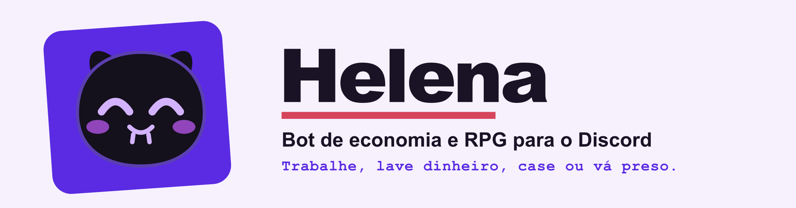
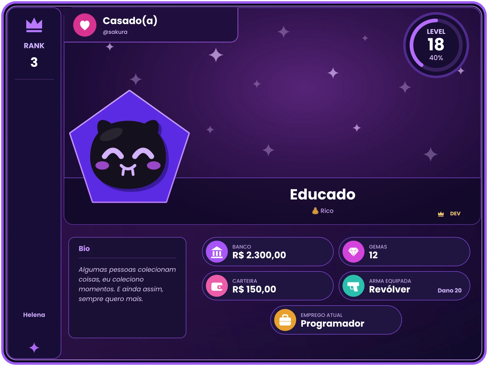

<div align="center">



<br>

[](https://vsync.lat/oauth2/authorize?client_id=235205613573263360&scope=bot&permissions=VIEW_CHANNEL,SEND_MESSAGES)
[](https://vsync.lat/tfe6pdxk)
[](https://helenacry.github.io/helena-bot/)
[](https://helenacry.github.io/helena-bot/wiki/)
[](https://github.com/helenacry/helena-bot)

</div>

## O que é

A **Helena** é um bot de economia e RPG para a [VSync](https://vsync.lat). Cada servidor tem a sua própria economia: você trabalha, guarda dinheiro, compra na loja, casa, duela e, se tiver coragem, comete crimes, lava o dinheiro sujo e tenta fugir da cadeia. Tudo vira um **cartão de perfil** com a sua cara.

| Recurso | O que tem |
|---|---|
| 💼 **Trabalho e banco** | 23 empregos, daily com sequência, missões, banco e transferências |
| 🛒 **Loja e bolsa** | loja com botões, inventário e um mercado que mexe nos preços |
| 🕵️ **Crime** | golpes, roubos, lavagem de dinheiro, ficha criminal, prisão e fuga |
| ⚔️ **Duelos** | armas, munição, colete e hospital |
| 💍 **Vida social** | casamento, família, conquistas, títulos e ranking |

<div align="center">

<br>
<sub>O cartão do <code>/perfil</code> é gerado pelo próprio bot.</sub>
</div>

## Comece em 1 minuto

1. **Adicione a Helena** ao seu servidor da VSync com o botão **Adicionar à VSync**, lá em cima.
2. **Peça ajuda:** digite `/ajuda` para ver as categorias e o que cada comando faz.
3. **Resgate o primeiro prêmio:** o seu primeiro `/daily` já abre a conta. Não precisa de cadastro.

Os comandos funcionam de duas formas: com a barra (`/saldo`) ou com o prefixo `h` (`hsaldo`). A [wiki](https://helenacry.github.io/helena-bot/wiki/) explica cada sistema, com os números atuais tirados do próprio bot, e o [painel da conta](https://helenacry.github.io/helena-bot/account/) deixa você coletar o daily e as gemas pelo navegador.

> Gostou? Deixe uma ⭐ no botão **Favoritar** acima: ajuda a Helena a chegar a mais servidores.

## Para quem desenvolve

Precisa de **Node.js 24** (o banco usa o `node:sqlite`, que já vem nele) e de um aplicativo de bot criado no portal do desenvolvedor da VSync.

```bash
npm install
cp .env.example .env      # no Windows: copy .env.example .env
npm start                 # depois de preencher o .env
npm test                  # os testes do bot
```

O site é um projeto à parte, em `site/` (Astro):

```bash
npm run site:install && npm run site:dev    # http://127.0.0.1:4321/helena-bot/
```

### Documentação

| Documento | O que tem |
|---|---|
| [Desenvolvimento](docs/development.md) | instalação, ambientes, variáveis, como criar um comando, testes |
| [Estrutura do projeto](docs/structure.md) | onde fica cada pasta |
| [Sistemas do jogo](docs/game-systems.md) | crime, perfil, painéis, layout V2, intervalo entre comandos, bolsa |
| [Desenho das respostas do bot](docs/bot-design.md) | recibo, cores, humores da pelúcia e texto das respostas no chat |
| [Painel do site (API)](docs/panel-api.md) | login com a VSync, rotas, segurança |
| [Site e wiki](docs/site.md) | o site em Astro, a wiki em Markdown, os portões de qualidade |
| [Hospedagem no Discloud](docs/hosting-discloud.md) | onde o bot oficial roda |
| [Hospedagem no Railway](docs/hosting-railway.md) | alternativa de hospedagem |
| [Notas jurídicas](docs/legal-notes.md) | o que os termos e a política cobrem e o que ainda precisa de decisão |

## Termos e privacidade

Leia os [Termos de uso](https://helenacry.github.io/helena-bot/terms/) e a [Política de Privacidade](https://helenacry.github.io/helena-bot/privacy/). A Helena não vende nada, não mostra anúncios e não é para menores de 12 anos.

## Créditos

- **Twemoji** (emojis do cartão de perfil): os desenhos são © Twitter, Inc. e colaboradores, mantidos pelo projeto [jdecked/twemoji](https://github.com/jdecked/twemoji) e usados sob a licença [CC-BY 4.0](https://creativecommons.org/licenses/by/4.0/). Chegam pelos pacotes `@twemoji/svg` e `@twemoji/parser` (MIT). Os desenhos não foram alterados.
- **Poppins** (fonte do cartão): © Indian Type Foundry, licença [SIL OFL 1.1](https://openfontlicense.org).
- **Bricolage Grotesque**, **Instrument Sans** e **Martian Mono** (fontes do site): licença [SIL OFL 1.1](https://openfontlicense.org), com a licença de cada uma ao lado dos arquivos em `site/src/assets/fonts/`.
- **Pagefind** (busca da wiki) e **Astro** (o site): código aberto, usados como dependências do projeto.

<div align="center">
<sub>Feito por <a href="https://github.com/matheustonon1">@matheustonon1</a> e <a href="https://github.com/agorismo">@agorismo</a>, da organização <a href="https://github.com/helenacry">helenacry</a>. A Helena não é um produto da VSync.</sub>
</div>
